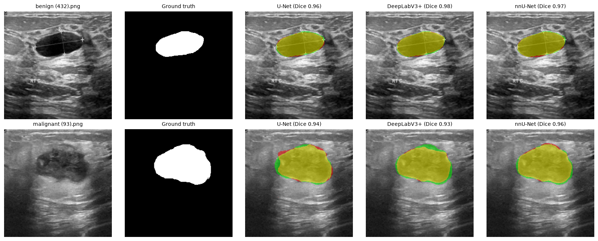
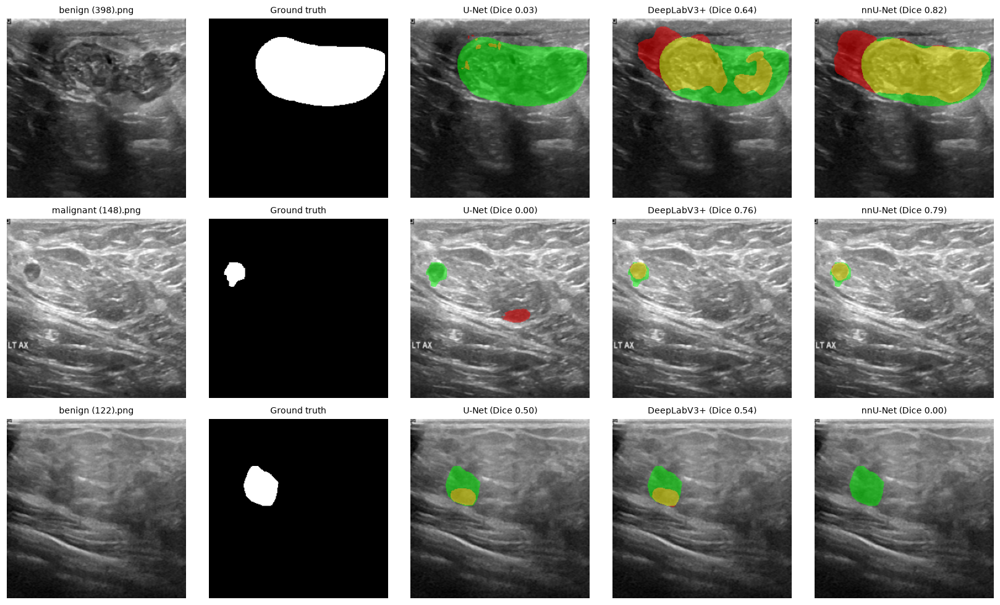
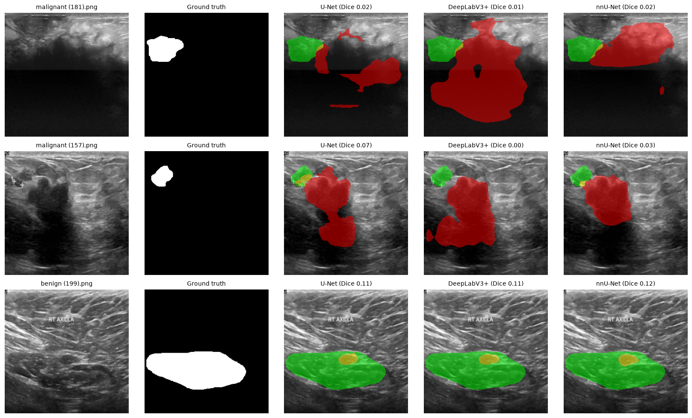

# Breast Ultrasound Tumor Segmentation: U-Net, nnU-Net and DeepLabV3+ on BUSI

## 1. Introduction to image segmentation

Image segmentation assigns a label to every pixel of an image. In this
project the task is **binary tumor segmentation** in breast ultrasound
images: for each image, a model outputs a mask in which tumor pixels are 1
and all other pixels are 0. Compared with image classification, which gives
one label per image, segmentation also tells *where* the tumor is and what
its shape and size are, which is useful for measuring tumors and for
planning further examination.

Segmenting ultrasound images is difficult. Tumor borders are often blurry,
the contrast between tumor and surrounding tissue is low, speckle noise is
strong, and dark regions (for example acoustic shadows) can look like
tumors. For these reasons we do not only report one overlap score but also
look at where each model fails.

## 2. Dataset

We use the BUSI breast ultrasound dataset with ground-truth masks
(647 images of benign and malignant tumors). The split is the one provided
with the dataset in `train.xlsx` and `test.xlsx`: **517 training images and
130 test images**. No new random split was created. The test images were
never used for training, planning or choosing a checkpoint.

## 3. Models

**U-Net** is an encoder-decoder network. The encoder repeatedly applies
convolutions and downsampling to capture context; the decoder upsamples
again to recover the resolution. *Skip connections* copy encoder features
to the decoder at the same resolution, so that the output keeps fine
spatial detail. Our version has four downsampling stages with a base width
of 32 channels (about 7.8 million trainable parameters) and is trained from
scratch.

**DeepLabV3+** uses a deeper encoder (a ResNet-50) with *atrous (dilated)
convolutions* in its last stage, so that the feature map keeps a higher
resolution (1/16 of the input size). An *ASPP* module (Atrous Spatial
Pyramid Pooling) looks at these features with several dilation rates
(6, 12, 18) and with global pooling to capture context at several scales. A
light decoder then fuses the result with low-level features (1/4 of the
input size) to sharpen the object borders. Our version has 40.3 million
trainable parameters and is trained from scratch, without ImageNet weights,
to match the U-Net setting.

**nnU-Net** is a *self-configuring* framework rather than one fixed
network. From the training data it derives automatically the preprocessing,
the network architecture (a U-Net variant), the patch and batch size, the
training schedule and the data augmentation. We used its 2D configuration,
trained on all 517 training images (fold `all`, so without a validation
set), with the trainer `nnUNetTrainer_50epochs`.

## 4. Experimental settings

All models use the same data, the same input size and the same evaluation.
nnU-Net configures itself automatically, so some of its settings cannot be
made identical to the other two models.

| Setting | U-Net | DeepLabV3+ | nnU-Net |
|---|---|---|---|
| Training / test images | 517 / 130 (from `train.xlsx` / `test.xlsx`) | same | same |
| Input and mask size | 256 × 256, grayscale | same | same |
| Normalization | scaling to [0, 1] | same | z-score per image (nnU-Net default) |
| Optimizer | Adam, learning rate 0.001 | same | SGD with Nesterov momentum, learning rate 0.01 with polynomial decay |
| Loss | 0.5 BCE + 0.5 soft Dice | same | Dice + cross-entropy (with deep supervision) |
| Batch size | 8 | 8 | 8 (overwritten in the plan) |
| Epochs | 50 (65 iterations each) | 50 (65 iterations each) | 50 (250 iterations each, 12,500 in total) |
| Data augmentation | none | none | nnU-Net default augmentation |
| Random seed | 42 | 42 | cannot be set from the command line |
| Pre-training | none | none | none |
| Inference | threshold 0.5 on the sigmoid output | same | argmax, with test-time augmentation (mirroring) |
| Checkpoint | final epoch | final epoch | final epoch |

Important differences: nnU-Net uses data augmentation and test-time
augmentation, and its 50 epochs correspond to about four times more
training iterations than the other two models. Its random seed could not be
fixed. These differences should be kept in mind when comparing the results.

## 5. Evaluation metrics

For a predicted tumor region *P* and a ground-truth region *G*:

- **Dice coefficient** = 2|P ∩ G| / (|P| + |G|). Overlap measure from 0 to
  1; higher is better.
- **Intersection over Union (IoU)** = |P ∩ G| / |P ∪ G|. A stricter overlap
  measure; higher is better.
- **HD95** is the 95th percentile of the distances (in pixels) between the
  boundaries of *P* and *G*, in both directions. It measures boundary error
  and is robust to a few outlier pixels; **lower is better**.

All metrics are computed per test image on the 256 × 256 masks with the
same code (`evaluate.py`) for all models, and then averaged over the
130 test images. If the prediction is empty but the ground truth is not,
Dice and IoU are 0 and HD95 is undefined. We therefore report HD95 in two
ways: averaged over the images where it is defined, and with undefined
values replaced by the image diagonal (362 px), which penalizes missed
tumors instead of ignoring them.

## 6. Results

### 6.1 Main results on the 130 test images

| Model | Dice | IoU | HD95 (px), undefined excluded | HD95 (px), undefined = 362 |
|---|---|---|---|---|
| U-Net | 0.6822 ± 0.2989 | 0.5843 ± 0.3001 | 43.03 ± 45.98 (4 excluded) | 52.84 |
| DeepLabV3+ | 0.7901 ± 0.2399 | 0.7019 ± 0.2527 | 24.25 ± 30.97 (1 excluded) | 26.85 |
| nnU-Net | **0.8245 ± 0.2204** | **0.7436 ± 0.2309** | **20.92 ± 29.78** (2 excluded) | **26.17** |

Values are mean ± standard deviation over test images. Dice and IoU: higher
is better; HD95: lower is better.

### 6.2 Distribution of the per-image results

| Model | Median Dice | Median IoU | Dice ≥ 0.8 | Dice < 0.5 | Dice = 0 |
|---|---|---|---|---|---|
| U-Net | 0.8114 | 0.6826 | 69 / 130 | 32 / 130 | 7 / 130 |
| DeepLabV3+ | 0.8869 | 0.7968 | 91 / 130 | 15 / 130 | 3 / 130 |
| nnU-Net | 0.9031 | 0.8233 | 100 / 130 | 10 / 130 | 2 / 130 |

For all models the median is much higher than the mean: most images are
segmented well, and a minority of failures lowers the average.

### 6.3 Error types

Each test image was assigned to one category by simple rules (missed tumor:
empty prediction; wrong location: Dice = 0 with a non-empty prediction;
over-segmentation: predicted area more than 1.5 times the true area;
under-segmentation: less than 0.5 times; inaccurate boundary: similar area
but Dice below 0.8; good: Dice ≥ 0.8).

| Category | U-Net | DeepLabV3+ | nnU-Net |
|---|---|---|---|
| Good | 69 | 91 | 100 |
| Inaccurate boundary | 23 | 21 | 16 |
| Over-segmentation | 9 | 8 | 9 |
| Under-segmentation | 22 | 7 | 3 |
| Wrong location | 3 | 2 | 0 |
| Missed tumor | 4 | 1 | 2 |

### 6.4 Mean Dice by tumor size

The test images were split into three groups of similar size by the
ground-truth tumor area.

| Tumor size | U-Net | DeepLabV3+ | nnU-Net |
|---|---|---|---|
| Small (44 images) | 0.6957 | 0.8203 | 0.8089 |
| Medium (43 images) | 0.7225 | 0.7925 | 0.8763 |
| Large (43 images) | 0.6282 | 0.7567 | 0.7887 |

## 7. Example visualization results

In all figures, each row is one test image. The columns show the original
image, the ground-truth mask and an overlay of the prediction of each model.
In the overlays, **yellow** is correctly predicted tumor, **red** is
predicted tumor that is not in the ground truth (over-segmentation) and
**green** is tumor that the model missed (under-segmentation). The Dice
score of each model is given in the title. The images were selected by fixed
rules, not by hand.

**Images that all models segment well** (highest Dice of the worst model;
one benign and one malignant image: benign (432) and malignant (93)):

Benign (432) is a well-defined dark oval and malignant (93) a large dark,
heterogeneous mass. All three models reach a Dice of 0.93 to 0.98, and the
remaining errors are thin rims along the tumor border (red and green
slivers).

**Images where the models differ most.** Benign (398) and malignant (148)
are the two images where nnU-Net gains most over U-Net. Benign (122) is the
image where it loses most: U-Net segments it partly, whereas nnU-Net misses
it completely.

In benign (398), a large heterogeneous mass, U-Net predicts almost nothing
(Dice 0.03), DeepLabV3+ covers part of it (0.64) and nnU-Net most of it
(0.82), with some over-segmentation at the upper left. In malignant (148),
a small dark round lesion, U-Net marks a different place (0.00), whereas
DeepLabV3+ and nnU-Net find the lesion (0.76 and 0.79) but cover it
slightly too little. In benign (122), a small low-contrast tumor, U-Net and
DeepLabV3+ find only its lower part (0.50 and 0.54), whereas nnU-Net
predicts nothing (0.00).

**Hard images** (the lowest Dice even for the best model: malignant (181),
malignant (157) and benign (199)):

In malignant (181) and (157), the true lesion is small and lies near the
left or upper-left border of the image, but all three models predict large
regions instead (for U-Net in (181) also fragmented ones) in the large dark
areas of the image (Dice 0.00 to 0.07). In benign (199), the true lesion is
a large elongated region in the lower half of a low-contrast image with an
"RT AXILLA" annotation, and all three models find only a small part of its
center (Dice 0.11 to 0.12).

Per-model figures of all 130 test images are in the `visualizations/`
folder of each model's output folder.

## 8. Findings

1. **nnU-Net gave the best results, followed by DeepLabV3+ and U-Net.** The
   order is the same for mean Dice (0.8245, 0.7901, 0.6822), mean IoU, median
   Dice and the number of images with Dice ≥ 0.8. nnU-Net also has the lowest
   HD95. A paired bootstrap over the test images (10,000 resamples) gives a
   mean Dice difference of +0.034 between nnU-Net and DeepLabV3+ (95%
   interval +0.011 to +0.059), +0.142 between nnU-Net and U-Net (+0.103 to
   +0.183) and +0.108 between DeepLabV3+ and U-Net (+0.074 to +0.144). None
   of the intervals includes zero, so the ordering is not explained by the
   choice of test images alone. These intervals only reflect the sampling of
   the 130 test images, not the randomness of training: each model was
   trained once with one seed, and nnU-Net was trained under different
   conditions (Section 4). The gap between nnU-Net and DeepLabV3+ in
   particular is small compared with the spread between images (standard
   deviation about 0.22 to 0.24) and should be treated with caution. With
   undefined HD95 values counted as 362 px, the two are almost equal (26.17
   and 26.85 px). U-Net is clearly behind both.

2. **The improvement comes mainly from fewer missed or under-segmented
   tumors.** Under-segmentation drops from 22 images (U-Net) to 7
   (DeepLabV3+) and 3 (nnU-Net), and the number of images with Dice < 0.5
   falls from 32 to 15 and 10. Over-segmentation hardly changes (9, 8 and 9
   images), and 16 to 23 images in each model have an inaccurate boundary
   although the tumor is found. Examples are benign (398), a large
   heterogeneous mass that U-Net almost misses (Dice 0.03) and that
   DeepLabV3+ and nnU-Net segment with Dice 0.64 and 0.82, and malignant
   (148), where U-Net marks the wrong place (Dice 0.00) and the other two
   models find the lesion (0.76 and 0.79).

3. **Low-contrast tumors are the main source of complete misses.** The
   images that U-Net missed completely include mostly benign tumors in
   low-contrast, striped tissue (for example benign (243), (294), (344) and
   (402)). nnU-Net's two empty predictions, benign (122) and benign (108),
   have the same appearance: a small tumor with almost the same gray level
   as its surroundings and no visible border. No test image has Dice = 0 in
   all three models; the images that one model misses are often segmented
   partly by another (for example benign (122) is under-segmented, not
   missed, by U-Net and DeepLabV3+). Several of the failed images (benign
   (243), (294) and (199)) carry an "axilla" annotation, which suggests that
   they were taken in the axilla rather than the breast. Because we did not
   check how well the other axilla images are segmented, we cannot say
   whether this explains the failures.

4. **Small malignant lesions next to large dark regions are the hardest
   cases.** For malignant (181) and (157), all three models reach a Dice of
   at most 0.07: the true lesion is small and lies near the border of the
   image, while the models predict large regions (for U-Net in (181) also
   fragmented ones) in the large dark areas of the image, which hardly
   overlap the lesion. Malignant (45) shows the same pattern for DeepLabV3+
   and nnU-Net (Dice 0.07 and 0.01). This also explains the very high HD95
   of these images (111 to 147 px for nnU-Net). Malignant (181) and (157)
   are the two images where even the best of the three models has the
   lowest Dice, so they are the hardest images in the test set. Benign (199)
   is the third hardest: the true lesion is a large elongated region in a
   low-contrast image, and all three models find only a small part of its
   center (Dice 0.11 to 0.12), a clear under-segmentation.

5. **Large tumors have the lowest Dice for all three models** (0.6282,
   0.7567 and 0.7887), while the best group differs (medium for U-Net and
   nnU-Net, small for DeepLabV3+). The group means are strongly affected by
   the few images with very low Dice, so this is a description, not a
   proven effect of tumor size.

6. **Dice, IoU and HD95 describe different aspects.** For example,
   DeepLabV3+ and nnU-Net differ more in mean Dice (0.0344) than in HD95
   with penalty (0.68 px), because HD95 is dominated by the few failed
   images, while Dice is also sensitive to small boundary differences on
   the many images that are found.

## 9. Conclusion

On the BUSI test set, nnU-Net achieved the best segmentation (mean Dice
0.8245, IoU 0.7436, HD95 20.92 px), DeepLabV3+ was second (0.7901, 0.7019,
24.25 px) and our U-Net was clearly lower (0.6822, 0.5843, 43.03 px). All
models segment most images well (median Dice 0.81 to 0.90), and their
differences come mostly from a minority of difficult images: tumors with low
contrast and no visible border, and some malignant cases next to large
dark regions.

These conclusions have limits. Each result comes from a single training run
with one random seed, and the test set has only 130 images. The three
models are not trained under completely identical conditions: nnU-Net uses
its own augmentation, normalization, optimizer, test-time augmentation and
about four times more training iterations, and the three networks differ
strongly in size. The differences can therefore not be attributed to the
architecture alone. The models were trained from scratch for a fixed number
of 50 epochs without a validation set, and the training curves of nnU-Net
were still improving at the end.

Possible next steps are to add a validation split, to repeat the training
with several seeds, to train all models with the same augmentation, to
use pre-trained encoders, and to report the results separately for benign
and malignant tumors.

## 10. Files

| Content | Location |
|---|---|
| Notebooks | `U_Net_segmentation.ipynb`, `nnU_Net_segmentation.ipynb`, `DeepLabV3Plus_segmentation.ipynb` |
| Model weights | `weights/` folder in each model's output folder under `outputs/` |
| Predicted test masks | `pred_masks/` folder in each model's output folder |
| Per-image metrics | `metrics.csv` in each model's output folder; all models together: `comparison/per_image_metrics_all_models.csv` |
| Evaluation code | `evaluate.py` (shared by all models) |

## References

- Ronneberger, O., Fischer, P., Brox, T. (2015). U-Net: Convolutional
  Networks for Biomedical Image Segmentation. MICCAI.
- Chen, L.-C., Zhu, Y., Papandreou, G., Schroff, F., Adam, H. (2018).
  Encoder-Decoder with Atrous Separable Convolution for Semantic Image
  Segmentation (DeepLabV3+). ECCV.
- Isensee, F., Jaeger, P. F., Kohl, S. A. A., Petersen, J., Maier-Hein, K. H.
  (2021). nnU-Net: a self-configuring method for deep learning-based
  biomedical image segmentation. Nature Methods.
- Al-Dhabyani, W., Gomaa, M., Khaled, H., Fahmy, A. (2020). Dataset of
  breast ultrasound images. Data in Brief.
